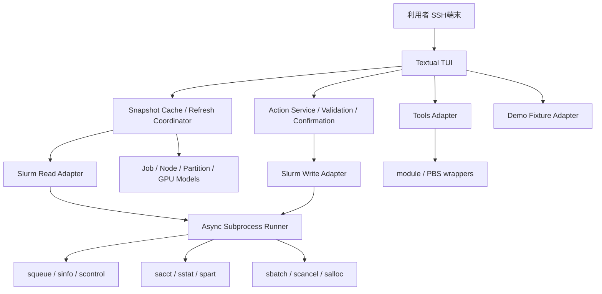

# Slurm TUI — Python製 Slurm / GPU / Job 統合ターミナルUI 設計書

- **文書**: `design.md`
- **プロジェクト名（仮）**: `hakusan-tui`
- **設計日**: 2026-11-09
- **ステータス**: 実装用設計案 v1.0
- **対象**: JAIST HAKUSANを初めて利用する学生・研究者、および日常的にGPUジョブを実行する利用者
- **UI言語**: 日本語を既定とする。将来英語に切り替え可能な設計。

> **出典と適用範囲**
> 添付の「計算機講習会 [HAKUSAN]」（2026/4/14、株式会社HPCソリューションズ）**Part 1・全58ページ**を基本要件とする。本書の「資料準拠」は同PDFの記載を指し、その他のダッシュボード、GPUメトリクス、詳細診断などは本プロジェクトによる拡張設計である。資料のPart 2（コンテナ、Jupyter等）・Part 3（conda/GPU講習）は**目次にあるだけ**なので、説明されていない操作を資料由来とは扱わない。
>
> **重要**: PDFのパーティション値・ノード台数・ソフトウェアバージョンは2026年4月の説明値。画面に表示する現在値は**必ずSlurmおよびサイトの`spart`コマンドなどから取得**する。サンプル値をリアルタイム値として表示しない。

---

## 1. 目的とプロダクト方針

### 1.1 解決したい問題

初心者が以下の操作を行うために、多数のLinux/Slurmコマンドを覚えなければならない。

- GPU（A40/A100/H100系）を使えるか、どのキューが空いているか把握する。
- 自分のジョブが**待機中（PENDING）なのか実行中（RUNNING）なのか**を確認する。
- 待機理由（`Resources`、`Priority`、制限超過など）と要求リソースを理解する。
- ジョブスクリプトを作り、パーティションやCPU/GPU/メモリ/実行時間を指定して投入する。
- 実行結果・ログ・過去の使用リソースを確認する。
- 不要なジョブを安全にキャンセルし、対話的ジョブを開始・終了する。
- `module`、コンパイラ、`/home`と`$JOBDIR`、PBS互換コマンドを正しく使う。

### 1.2 解決方法

**Textualによる単一のPython TUI**を提供する。1画面上部でタブを切り替え、表の行を選択すると詳細が開く。主な操作はキー・マウスのどちらでもできる。

設計原則:

1. **Beginner First**: `PD`を「待機中」、`R`を「実行中」と表示し、生コマンドと説明も併記する。
2. **Read First, Act Safely**: 閲覧は簡単に、投入・キャンセル・保留/再実行は実行コマンドを確認してから。
3. **Site-Aware**: HAKUSAN固有の`spart`、`$JOBDIR`、パーティション構成を扱うが、一般的なSlurmにも移植できる。
4. **Non-Invasive**: ログインノードで重い処理を実行しない。Slurmへの照会を過剰に行わない。
5. **Truthful Metrics**: 「割当済GPU」と「GPU実使用率」を混同せず、取得不可なら`未取得`と表示する。
6. **One Application**: 監視・操作・学習を一つのTUIに集約する。外部Webサーバは不要。

### 1.3 MVPの実行形態

```bash
# Mac / Linuxから接続（資料 p.18）
ssh <JAISTユーザー名>@hakusan1
# hakusan2でも可。大学の認証・ネットワーク要件に従う。

# ログインノード上で軽量なTUIを起動
hakusan-tui
```

- **MVPはHAKUSANログインノード上の既存認証セッションで稼働**するローカルCLI方式。TUIからSSH認証情報を収集・保管しない。
- Mac上でTUIが遠隔コマンドを直接実行するSSHリモートモードは将来拡張。MVPでは必須にしない。
- `--demo`はSlurm未導入のMac/Linuxでも実行でき、サンプルデータでUIを体験できる。
- 一般ユーザー権限のみ使用。`sudo`、管理者用API、Slurmデーモン常駐は不要。

---

## 2. HAKUSAN環境の前提（資料準拠）

| 対象 | 資料の説明 | 設計への反映 |
|---|---|---|
| ログインノード | `hakusan1` / `hakusan2` | TUIの起動場所。重い計算・GPU実行はしない（p.5–6, 18–19） |
| CPUノード | `lcpcc-001`〜`lcpcc-124`、124台 | `sinfo`/`scontrol`で実際の状態を取得（p.5–6） |
| A100ノード | `spcc-a100g01`〜`spcc-a100g10`、各2 GPU | GPUタイプの分類例（p.7, 13） |
| A40ノード | `spcc-a40g01`〜`spcc-a40g20`、各2 GPU | GPUタイプの分類例（p.7, 14） |
| クラウド計算ノード | CPU、H100の1/4相当、小規模/大規模GPU、大容量メモリ | VMノード台数は変動。**H100 1/4を物理GPU 1枚と同一視しない**（p.9–11） |
| 共有領域 | `/home` | スクリプト・ソース・成果物保存（p.8, 22） |
| 高速ジョブ領域 | `/JOBs`、ジョブごとの`$JOBDIR` | ステージング用。ジョブ終了で削除（p.8, 22, 50–52） |
| CPUパーティション | `TINY`, `DEF`, `SINGLE`, `LONG`, `SMALL`, `LARGE`, `XLARGE`, `X2LARGE`, `LONG-L` | 選択肢の例。実際の制約は現行設定に照合（p.38） |
| GPUパーティション | `GPU-1`, `GPU-S`, `GPU-L`, `GPU-1A`, `GPU-LA`、ほかVM系 | A40/A100/VM等を分類。実際の制約は現行設定に照合（p.39） |
| HAKUSAN独自コマンド | `spart` | パーティション一覧/制限情報の優先ソース（p.38–39） |
| ジョブシステム | Slurm、PBSラッパーも提供 | Slurmを主経路にし、PBS互換操作は利用可能時に追加（p.36–56） |

**サイト制約**:

- 参考上限として資料は「CPU系インタラクティブジョブ48時間」「GPU系インタラクティブジョブ12時間」を説明している（p.38–39）。最新ポリシーは自動的に検証する。
- 資料にはパーティションごとのCPU/GPU/メモリ、ノード数、利用時間、ユーザー当たり同時実行・キュー数などが掲載されている（p.38–39）。**運用上の判定に静的コピーを使わない**。
- HAKUSANログインノードではユーザープログラムを実行しない。コンパイルも計算ノード上を推奨（p.19）。TUI自体は軽量な管理操作に限定する。

---

## 3. 機能要件一覧と資料対応表

**表の「サポート」は、GUI操作・状態表示・スクリプト生成・ガイド表示のいずれかを実装する意味。** クラスタの権限/サイト固有設定で実行不能な操作は、誤作動させず無効化し、理由を表示する。

| ID | 機能 | 資料ページ | TUI上の提供方法 | 優先度 |
|---|---|---|---|---|
| F01 | HAKUSAN概要、CPU/GPU/VMノード構成 | 5–14 | 概要/GPU/ノード | P0 |
| F02 | SSHによるログイン、ログインノードの注意 | 16–19 | はじめての方/診断 | P0 |
| F03 | `/home`、`/JOBs`、`$JOBDIR` | 8, 22, 50–52 | ツール/ジョブ投入 | P1 |
| F04 | GCC、Intel、NVIDIA HPC SDK、LLVM、CUDA、MPIのガイド | 24–26, 31–34 | ツール/ヘルプ/テンプレート | P1 |
| F05 | `module avail`, `module list` | 27–30 | ツール > Module | P1 |
| F06 | `module load`, `module unload` | 27–30 | ジョブスクリプト生成・対話シェル案内 | P1 |
| F07 | CPU/GPUパーティションの比較と制限 | 38–39 | ノード > パーティション | P0 |
| F08 | サイトコマンド`spart` | 38–39 | パーティション制限詳細/生表示 | P1 |
| F09 | `sbatch`によるバッチジョブ投入 | 40–42 | 投入 | P0 |
| F10 | `#SBATCH`、CLI引数によるリソース指定/上書き | 41–44 | フォーム + 生成スクリプト + コマンドプレビュー | P0 |
| F11 | `-p`, `-J`, `-o`, `-e`, `-n`, `--mem`, ノード数等 | 41–44 | 投入フォーム | P0 |
| F12 | `--mail-type`, `--mail-user`通知 | 44–45 | 投入フォーム > 通知 | P1 |
| F13 | `salloc`対話ジョブ・終了 | 34, 43 | ツール > 対話ジョブ | P1 |
| F14 | `squeue`、`squeue -l` | 47–48 | 自分のジョブ/全体キュー | P0 |
| F15 | `JOBID`, `PARTITION`, `STATE`, `TIME`, `TIME_LIMIT`, `NODELIST(REASON)` | 47–48 | 一覧・詳細 | P0 |
| F16 | `scancel` | 49 | 自分のジョブ詳細 > キャンセル | P0 |
| F17 | `sacct`、経過時間、割当CPU、`MaxRSS`、`AllocTRES` | 46 | 履歴/ジョブ詳細 | P0 |
| F18 | 出力ログ確認（`%j`, `%x`を含む） | 41, 53–54 | 自分のジョブ/履歴 > ログ | P1 |
| F19 | ステージング（input→`$JOBDIR`→outputを戻す） | 50–52 | 投入テンプレート/ツール | P1 |
| F20 | シングル/MPI/CUDAの実行例 | 32–34, 53–54 | 投入テンプレート/学習ガイド | P1 |
| F21 | PBS互換`qsub`,`qstat`,`qdel` | 56 | ツール > PBS互換 | P2 |
| F22 | PBS互換`qalter`,`qhold`,`qrls`,`qrerun` | 56 | ツール > PBS互換（詳細操作） | P2 |
| F23 | `pbsnodes`,`mpiexec`,`generate_pbs_nodefile` | 56 | ノード参照/テンプレート/コマンドガイド | P2 |
| F24 | 公式/学内マニュアルへの誘導 | 38–39, 46–48, 57–58 | ヘルプ | P1 |
| F25 | GPUノード割当状況、GPU型別の概況 | 5, 7, 10, 13–14, 39 | GPU | P0（**追加UI**） |
| F26 | ジョブ待機理由の日本語説明・対処案 | 47–48 | キュー/詳細 | P0（**追加UI**） |
| F27 | GPUの実使用率/VRAM/温度 | 資料のPart 1には**具体的な監視手順なし** | GPU、取得可能時のみ | P2（**追加機能**） |
| F28 | Slurmノード状態/リアルタイム更新 | 資料の構成概説からの**拡張** | 概要/ノード | P0 |

**対象外を明示**: ログイン情報の保存、クラスター管理者向けノード制御、管理者権限での他人のジョブキャンセル、コンテナ実行UI、Jupyter起動管理、conda環境作成は初期版の範囲外。後者3つはPart 2/3の講習内容が別資料にあるため、まずは「将来拡張」とする。

---

## 4. 画面構成と操作体系

### 4.1 単一アプリ・9メインタブ

| No. | タブ名 | 主な内容 |
|---|---|---|
| 1 | **概要** | クラスタの全体像、状態サマリー、GPU割当概況、ジョブ件数 |
| 2 | **自分のジョブ** | 実行中/待機中ジョブ、詳細、ログ、キャンセル |
| 3 | **キュー** | 全ユーザーの実行/待機一覧、待機理由、パーティション別混雑状況 |
| 4 | **GPU** | GPU型/ノードごとの資源割当状況、可能なら実使用率 |
| 5 | **ノード** | CPU/GPU/VMノード一覧、パーティション、`spart` |
| 6 | **ジョブ投入** | テンプレート、フォーム、`sbatch`、ジョブスクリプト生成 |
| 7 | **履歴** | `sacct`検索、終了理由、実績、結果ログ |
| 8 | **ツール** | Module、対話ジョブ、ステージング、PBS互換、環境診断 |
| 9 | **ヘルプ** | はじめての方、Slurm用語、資料対応、コマンド早見表 |

- **ヘッダー共通表示**: `HAKUSAN | <ユーザー> | <ホスト> | 最終更新 13:20:08 | 接続: 正常/エラー | 読取専用`。
- **フッター共通表示**: ショートカット、直近エラー/注意、更新間隔。
- **狭い端末**: タブを横スクロール。`1`〜`9`でも切替可。表は横スクロール、表示列を減らす。
- **詳細画面**: `Enter`でモーダルまたは右ペイン。閲覧元の選択行とフィルターは保持。
- **日本語**: 表のタイトル・ツールチップ・エラー文は日本語。生のSlurm状態/コマンドも確認可能。

### 4.2 画面イメージ（80〜120列のSSH端末）

```text
┌ HAKUSAN TUI ─ user01@hakusan1 ─ 最終更新 13:20:08 ─ Slurm 正常 ┐
│ 概要 │ 自分のジョブ │ キュー │ GPU │ ノード │ 投入 │ 履歴 │ ツール │ ヘルプ │
├─────────────────────────────────────────────────────────────┤
│ 自分のジョブ   実行 2    待機 3    終了直近24h 4                 │
│ クラスタ全体   実行 128  待機 72   利用可能ノード 41             │
│ GPU (Slurm割当ベース)                                         │
│   A40     割当 [███░░░░░░░]   12 / 40 ※例示値                  │
│   A100    割当 [████░░░░░░]    8 / 20 ※例示値                  │
│   H100 VM 割当 [???]          情報取得中/構成に依存            │
│                                                               │
│ 自分の待機ジョブ                                               │
│ ID       名前          区分     状態    待機理由               │
│ 126843   train_vla     GPU-1A   待機中  Resources              │
│ 126850   preprocess    DEF      待機中  Priority               │
│                                                               │
│ [Enter]詳細 [S]ジョブ投入 [R]更新 [/]検索 [?]ヘルプ [Q]終了   │
└───────────────────────────────────────────────────────────────┘
```

**注意**: 上記のジョブID、資源数、稼働件数は**UI設計用のダミーデータ**。実環境の状態を示すものではない。

### 4.3 キー操作

| キー | 動作 |
|---|---|
| `1`〜`9` | メインタブを直接選択（入力欄にフォーカス中は無効） |
| `Tab` / `Shift+Tab` | 操作対象を移動 |
| `↑` / `↓` | リスト選択 |
| `Enter` | 詳細表示または選択を確定 |
| `Esc` | モーダルを閉じる/直前に戻る |
| `/` | 表を検索・絞り込み |
| `r` | 現在タブを手動更新（更新頻度制限あり） |
| `s` | ジョブ投入タブへ |
| `c` | 自分のジョブで選択中のジョブをキャンセル確認（誤操作防止の二段階） |
| `?` | その画面の説明 |
| `q` | 終了確認（未保存フォームがある場合のみ確認） |

---

## 5. 各タブの詳細仕様

### 5.1 「概要」タブ

**表示するカード**:

- 自分のジョブ: 実行中/待機中/完了/失敗の件数。
- 全体のジョブ: 実行中/待機中/完了処理中の件数（見える範囲で）。
- CPUノード: `IDLE`、`ALLOCATED`、`MIXED`、`DRAIN`、`DOWN`等。
- GPU資源: GPUタイプ別**総割当可能数/割当済数/未割当の推定**。不足する値は`不明`。
- 更新時刻と取得元: `squeue`、`sinfo`、`scontrol`等を表示。
- 待機ジョブ上位5件、最近終了した自分のジョブ上位5件。

**処理**: 他タブと同じデータを共通キャッシュから表示。概要タブのためだけに毎秒コマンドを発行しない。

### 5.2 「自分のジョブ」タブ

**列**: `JOBID`、名前、パーティション、状態（日本語+短縮コード）、経過時間、制限時間、要求CPU、要求GPU、要求メモリ、ノード数、割当ノード/待機理由。

**フィルタ**: `すべて / 実行中 / 待機中 / 完了処理中 / 保留・停止`、ジョブID・名前・パーティションの検索。

**詳細ペイン**:

- ジョブ基本情報: 所有者、State、Reason、Partition、SubmitTime、StartTime、TimeLimit、WorkDir、StdOut/StdErr、ExitCode（取得可能な場合）。
- リソース: `ReqTRES`、`AllocTRES`、CPU/メモリ/GPU、ノード/タスク、必要なら`Gres`。
- 実行中: `sstat`によるジョブステップ単位の統計（利用可能時）。
- ログ: 標準出力・標準エラーを読み取り専用の末尾表示。上限1MiB、ページング/再読み込みあり。
- 操作: `キャンセル`、コマンド表示、提出元のスクリプトを編集用に開く（ユーザーの既存ファイルがある場合のみ）。

**キャンセルフロー**:

1. `c` → 選択したジョブID・名前・状態・所有者を表示。
2. 現在のユーザー所有であることを再検査。
3. `scancel <JOBID>`をプレビュー。`はい、キャンセル`を選んだ場合に限り実行。
4. 成功/失敗を通知し、`squeue`を再取得。**成功を確認する前に画面から消さない**。
5. `--readonly`では無効。他人のジョブは常に表示のみ。

### 5.3 「キュー」タブ

**目的**: キューに入っているジョブを見たい人が、`squeue`の仕組みを知らずに状況を理解できること。

- 全ユーザーで**閲覧可能な**ジョブ一覧を`実行中/待機中`に分ける。
- `USER / PARTITION / STATE / TIME / TIME_LIMIT / NODELIST(REASON)`を含む表。
- パーティション別に実行数・待機数・混雑を集計する。
- 待機理由のツールチップ例:
  - `Resources`: 現在、必要な資源を割り当てられない。
  - `Priority`: より優先度の高いジョブを先に処理している。
  - `Dependency`: 依存先のジョブ完了などを待っている。
  - `QOS*`、`Assoc*`: ポリシー/上限に関連した可能性。管理者設定を参照。
  - その他: 理由コードをそのまま保持し、未知の理由として表示。
- **予定開始時刻**: `squeue --start`等で取得できる場合のみ「Slurm推定」と明記し、**保証しない**。バックフィルスケジューラ未設定なら非表示。
- `Enter`で詳細（他人のジョブは閲覧許可された情報のみ、操作ボタンは出さない）。
- 画面内の「全体」は、**ユーザーに公開されているジョブの集合**。制限により一部しか見えない場合は明示。

### 5.4 「GPU」タブ

2種類の情報を明確に分離する。

**A. いつでも取得を試みる Slurm割当情報（P0）**

- GPUノード一覧: ノード名、所属パーティション、状態、GPU型、GRES総数、GRES割当数、GRES未割当数、割当ジョブ。
- グループ別集計: A40 / A100 / H100 VM / その他 / 不明。
- `GRES`、`GresUsed`、`CfgTRES`、`AllocTRES`など実際に存在するフィールドから計算。
- **空きGPU数**は、総数−割当数が確実に評価可能な場合のみ表示。「Slurm上の未割当」であり、ユーザーが必ず投入できるという意味ではない。
- ノードが同時に複数パーティションに属しても**同一GPUを重複集計しない**。
- H100の分割GPU/仮想GPUは資源単位を別表示する。**MIG・仮想化・GPUの1/4等を無条件に物理GPU枚数へ加算しない**。

**B. 取得可能な場合のみ表示する実機メトリクス（P2）**

- GPU利用率（%）、VRAM使用量、VRAM総量、温度、ジョブ単位のメトリクスを可能な範囲で表示。
- `sacct`のGPU TRES統計（`gres/gpumem`、`gres/gpuutil`など）を優先。ただしサイトのaccounting設定に依存し、**MIGでは利用率が収集できないことがある**。
- `nvidia-smi`をログインノードや全計算ノードに対して無許可で連続実行しない。
- 必要なら**ユーザー本人の割当済ジョブ内**で、明示的オプトインした監視プロセスがCSV/JSONを記録する方式を追加する。勝手に`srun`ステップを起動してジョブ資源を奪わない。
- 未対応時は`取得不可（Slurm accounting未設定/MIG/権限不足など）`。**0%と表示しない**。

### 5.5 「ノード」タブ

**内部サブビュー**: `ノード一覧` / `パーティション一覧` / `制限比較`。

- ノード一覧: 名前、CPU、メモリ、GPU/GRES、現在状態、利用可能性、理由。
- CPU/GPU/VMの種別ごとにフィルタ。Unknownも扱う。
- `IDLE`、`ALLOCATED`、`MIXED`、`DRAIN`、`DOWN`などを日本語化。
- パーティション一覧: パーティション名、対象ノード、デフォルト、MaxTime、GPU/CPU、稼働状態等。
- `spart`が利用可能なら**現行のサイト制限を優先**し、ユーザー当たり同時実行/キュー数を表示。解析できない出力は原文で確認できるようにする。
- `spart`がない場合は`sinfo`/`scontrol`の基本情報のみ表示。**これらのコマンドだけで確定できないユーザー上限は空欄**。
- ジョブ投入ウィザードへ「このパーティションを使う」導線。

### 5.6 「ジョブ投入」タブ

**1. テンプレート選択**: `CPUシングル` / `CPUマルチコア` / `MPI（単一/複数ノード）` / `CPUでのコンパイルと実行` / `GPU上でのCUDAコンパイルと実行` / `Python AI学習` / `高速ストレージ使用` / `既存スクリプトから投入`。

**2. 入力フォーム**:

| 項目 | 既定/挙動 | 検証 |
|---|---|---|
| ジョブ名 | 自動提案、変更可 | Slurmが許容する名前形式を確認 |
| パーティション | `sinfo`/`spart`から選択 | 現行の有効パーティションか |
| タスク数 | `--ntasks`（`-n`） | 正整数、上限警告 |
| CPU/タスク | `--cpus-per-task` | 正整数、`ntasks`との積の確認 |
| ノード数 | `--nodes` | 正整数、パーティション許容量 |
| メモリ | `--mem`（例`32G`） | 単位/上限 |
| GPU | 構成/パーティションに応じ`--gres=gpu:N`等 | 実サイトのGRES表記に一致するか |
| 時間 | `--time` | パーティション上限を超えないか |
| 標準出力/エラー | `%x-%j.out`等 | 安全なパス、ファイル名展開の説明 |
| メール | `--mail-type`、`--mail-user` | タイプ列挙、メール形式 |
| モジュール | 使用可能なmoduleを複数選択 | ジョブスクリプトへ`module load`を記述 |
| 実行コマンド | ユーザーがスクリプト/実行を指定 | **ログインノードでは実行しない** |
| ステージング | input/outputを選択 | `JOBDIR`の有無を実行時チェック |

**3. 検証・プレビュー**:

- 使用するパーティションの制約と照合。確定できない値は「要確認」とする。
- `--ntasks`とCPUコア数は常に同義ではないため、フォーム上で説明。
- **サイトのデフォルトを推測して暗黙に使用しない**。未指定なら「クラスタ既定を使用」と明示。
- 複数ノードではMPI等の通信方式が必要な場合があることを警告。
- スクリプト全文・`sbatch`コマンド・出力先を表示。**保存するまでは投入しない**。
- `Dry-run`ボタンは**内部検証のみ**を意味し、Slurmに本当に受理されることは保証しない。`sbatch --test-only`に対応するクラスタなら別途オプションで検証可能。

**4. 保存・投入**:

- 保存先は原則`~/slurm_jobs/<job_name>/job.sh`。既存ファイルは無断上書きしない。
- `sbatch --parsable job.sh`を実行し、返されたJob IDを保存/表示する。
- 送信後「自分のジョブ」タブへ移動できる。投入失敗時はstderrを表示。
- 初期版では任意のコマンドをログインノードで実行するボタンは提供しない。

**生成例（サイトにより変更可能）**:

```bash
#!/bin/bash
#SBATCH --job-name=train_vla
#SBATCH --partition=GPU-1A
#SBATCH --nodes=1
#SBATCH --ntasks=1
#SBATCH --cpus-per-task=4
#SBATCH --mem=32G
#SBATCH --time=02:00:00
#SBATCH --output=%x-%j.out
#SBATCH --error=%x-%j.err

set -euo pipefail
cd "$SLURM_SUBMIT_DIR"

# 例：サイトの利用可能モジュールを確認して有効化
# module load cuda

# 実行環境の準備はジョブ内で行う
python train.py
```

> これは**スクリプト書式の例**であり、`GPU-1A`で必要となるCPU/GPU数やモジュールの具体的な利用可否を保証しない。**GPU要求は現行サイト設定に照合し、必要なら`--gres`などを生成**する。Python環境・プログラムはユーザー側で準備する。

### 5.7 「履歴」タブ

- デフォルトは自分の過去24時間/7日間のジョブ。範囲選択で過去30日までなどを指定。
- `JOBID`、名前、State、ExitCode、Partition、Elapsed、AllocCPUS、AllocTRES、MaxRSS、開始/終了時刻。
- ジョブ単位と`.batch`/`.0`など**ステップ単位**を階層表示。`MaxRSS`がトップ行にないことを理解して表示する。
- `MaxRSS`は取得できるまで`未確定`。終了直後のaccounting反映遅延にも対応。
- ジョブ選択で「要求資源と実績」の比較（取得できる範囲のみ）、ログ表示、再投入用コピー生成（**再投入は自動実行しない**）。
- `sacct`が利用不可/非公開ならメッセージを表示し、他の機能は維持する。

### 5.8 「ツール」タブ

**A. Module**

- `module avail`、`module list`、`module show`相当を表示。
- `module load` / `unload`を実行する方法をガイドし、選択したモジュールを**今後生成するジョブスクリプトへ反映**できる。
- `module`は通常シェル関数/初期化が必要。サブプロセスで実行した`module load`は**起動元や次の別プロセスに引き継がれない**。UIに「現在のログインシェルを変更した」と誤表示しない。
- コンパイル/MPIツールの`which mpicc`、`which icx`等は**モジュール適用済みの一時シェル内で診断**する。あくまで読み取り用の軽量診断。
- `gcc`/`g++`/`gfortran`、`icx`/`icpx`/`ifx`、`mpicc`/`mpiicx`、`nvcc`等の**コンパイルコマンドをジョブスクリプトとして生成**し、計算ノード上で実行できる。`module load`→コンパイル→実行の順番を可視化する。コンパイルをTUIのログインノード上で直接実行する機能は作らない。

**B. 対話ジョブ**

- 利用可能なパーティションとリソースを選択→`salloc`コマンドを表示→明示確認。
- 実行はTextual `App.suspend()`で**端末制御を一時的に対話セッションへ渡す**方式。PTY/STDIN/STDOUTを占有する`salloc`をバックグラウンドworkerで通常実行しない。
- サイト設定により`salloc`後のシェル動作が異なるため、実行先ホストを確認して表示。必要に応じて`srun --pty`などはサイト設定に従ったガイドを示す。
- **対話シェルで`exit`**すると割当が解放されTUIへ復帰。`Ctrl+C`で待機を中断した場合の状態も確認。
- 計算ノードに入れたかは`hostname`等でユーザーが検証できるようにする。無断で独自SSH接続しない。

**C. 高速ストレージ/ステージング**

- `/home`と`$JOBDIR`の違い、ジョブ終了後に`$JOBDIR`が削除される注意を表示。
- input→`$JOBDIR`、計算実行、output→`$SLURM_SUBMIT_DIR`を含む**ステージング付きジョブテンプレート**を生成。
- 転送失敗時の失敗検出、終了時copy-backの処理方法、必要容量・経過時間の注意を説明。
- 計算中の`$JOBDIR`をTUIから消去するボタンは作らない。

**D. PBS互換**

- 初期表示は「上級者向け」。`command -v`等でラッパーの存在を検出。
- `qstat`/`pbsnodes`は読み取り表示、`qsub`はジョブ投入としてコマンドプレビュー付き。
- `qdel`、`qalter`、`qhold`、`qrls`、`qrerun`は**所有者検証 + 二段階確認**。設定/環境で不許可なら無効。
- `mpiexec`と`generate_pbs_nodefile`は**ジョブスクリプト内部での利用例・説明**としてサポート。端末から誤ってジョブ外実行しない。
- **すべてのPBSオプションをサポートしているわけではない**との資料記載（p.56）に従い、サポート外なら`未対応`を明示。

**E. 環境診断**

- `hostname`、ユーザー、`command -v sbatch`、`sinfo`の基本応答、Slurmバージョン、`spart`/`module`/`sacct`/PBSラッパーの利用可能性を表示。
- タイムアウト、ネットワーク障害、Slurm DB障害、権限不足を区別。
- CPU/GPU処理のベンチマークなど、ログインノードに負荷をかける診断はしない。

### 5.9 「ヘルプ」タブ

- 「最初のジョブを投入する」「GPUを使う」「待機中の理由を見る」「ログを読む」「ジョブを終了する」のガイド。
- 用語辞典: Slurm、パーティション、ノード、ジョブ、タスク、GPU、GRES、TRES、MIG、PENDING、RUNNING、DRAIN、CPUメモリ、VRAM、`$JOBDIR`。
- 画面ごとに「この画面で使うコマンド」と「資料の該当ページ」を表示。
- 参照資料・公式マニュアルは末尾の「参考リンク」を使用する。

---

## 6. システムアーキテクチャ

### 6.1 推奨技術

| 層 | 技術 | 理由 |
|---|---|---|
| TUI | **Textual** + Rich | タブ、表、入力、モーダル、CSS、非同期ワーカーを利用できる |
| 言語 | Python **3.11+** | 型注釈、非同期subprocess、保守性 |
| CLI | `argparse` または Typer | `--demo`等の起動オプション |
| データモデル | dataclass または Pydantic v2 | Job、Node、Partition、GPUの標準モデル |
| 設定 | TOML (`tomllib`, `platformdirs`) | ユーザーごとの設定保存 |
| Slurm連携 | **公式Slurm CLIのsubprocess実行** | root権限/REST API設定なしで導入しやすい |
| テスト | pytest / pytest-asyncio / Textual Pilot | Slurm実機なしでも回帰テスト可能 |
| 品質 | Ruff / mypy | 型と実装品質を維持 |
| パッケージ | `pyproject.toml` + `uv.lock` | Claude Codeで再現可能な構築 |

Textual/Slurm依存パッケージは`uv.lock`で固定し、開発時に対応バージョンの公式ドキュメントを確認する。

### 6.2 構成図



### 6.3 基本設計

- **Adapter Protocol**: `get_jobs`, `get_nodes`, `get_partitions`, `get_job_detail`, `get_history`, `submit_job`, `cancel_job`等を定義。
- **CLIアダプター**: Slurm出力をパースして共通モデルへ正規化。UIには生出力を直接渡さない。
- **デモアダプター**: JSONフィクスチャを利用。Slurmコマンドなしで全タブを起動できる。
- **サイトプロファイル**: HAKUSAN専用の`spart`解析、パーティション表示分類、`$JOBDIR`テンプレートをアダプターとは分離。
- **キャッシュ**: 各タブが別々に同じ`squeue`を呼ばない。更新周期内はスナップショットを使う。
- **操作ログ**: ローカルのアプリ操作（時刻、ジョブID、コマンド種類、成功/失敗）を記録。ジョブ内容や認証情報は記録しない。

---

## 7. Slurmコマンド仕様と取得方針

### 7.1 読み取りAPI相当

| 目的 | 一次候補 | フォールバック・備考 |
|---|---|---|
| ジョブ一覧 | `squeue --json` | `squeue -h -o ...`。利用不可ならパーサー切替 |
| 自分のジョブ | `squeue --me --json` | `squeue -u <user>` |
| ノード/パーティション | `sinfo --json` | `sinfo -N -h -o ...`、`scontrol show node` |
| ジョブ詳細 | `scontrol show job <JOBID> -o` | 権限で非表示の情報はそのまま扱う |
| ノード詳細 | `scontrol show node <NODE> -o` | Slurmから得られるCPU/メモリ/GRES/状態 |
| サイト制限 | `spart` | 存在しない場合は`sinfo`/`scontrol`の取得可能範囲 |
| 完了/過去履歴 | `sacct -n -P -S <DATE> -u <user> --format=...` | ジョブ/ステップを分けて解析 |
| 実行中ステップ統計 | `sstat -j <JOBID> --format=... -P` | jobacct_gather設定と閲覧権限に依存 |
| 推定開始 | `squeue --start` | 対応時のみ、推定と明記 |
| Module | ログイン初期化済みbashで`module avail/list/show` | シェル関数を考慮。標準エラーにも結果が出る場合あり |

- `--json`は現行Slurmとサイト構成の可否を**起動時にCapability Detection**して選択。SlurmのJSONスキーマを固定決め打ちしない。サンプルのバージョンごとにフィクスチャを持つ。
- フォーマット指定が必要なフォールバックではヘッダーを除き、区切り形式をテストする。**job name等のユーザー入力を含む区切り文字問題**に注意し、破損行は推測補完せず警告付きでスキップ/原文表示。
- `sacct -P`はパイプ区切り。`-n`はヘッダーを省く。対象期間を必ず指定し、大量の全履歴を無制限取得しない。
- `scontrol`のフィールドや`GresUsed`はクラスタ設定に依存し、無い値はNULLで保持。
- ジョブIDは通常数値だが、配列ジョブ/step ID/クラスタ接尾辞を持つ表示に対応。**操作対象はトップレベルジョブIDに正規化**する。

### 7.2 書き込みコマンド

| 操作 | コマンド | 実行条件 |
|---|---|---|
| ジョブ投入 | `sbatch --parsable <script>` | 明示確認、保存済みスクリプト |
| ジョブキャンセル | `scancel <JOBID>` | 自分のジョブ + 確認 |
| 対話ジョブ開始 | `salloc ...` | 端末サスペンド中の対話セッション |
| PBS互換操作 | `qsub`/`qdel`等 | ラッパー検出 + 上級者モード + 明示確認 |

**実行は`asyncio.create_subprocess_exec(*argv)`など引数配列で行い、ユーザー入力を`sh -c`/`shell=True`へ連結しない**。対話ジョブは端末占有が必要なので例外的に`suspend()`中でPTYを使う。外部のスクリプト実行はジョブ割当内に限定する。

### 7.3 ステータス正規化

```python
JobState = Literal[
    "PENDING", "RUNNING", "COMPLETING", "COMPLETED", "FAILED",
    "CANCELLED", "TIMEOUT", "OUT_OF_MEMORY", "SUSPENDED",
    "NODE_FAIL", "PREEMPTED", "UNKNOWN",
]
```

- Slurmが返す未知状態は`UNKNOWN`扱いにして元文字列を残す。
- PENDINGである理由とジョブ状態は**別フィールド**にする。
- ノード名と`NODELIST(REASON)`は実行中と待機中で意味が異なるため、明確に分離。
- `Elapsed`はバックエンドの値を優先。UI側推定の残り時間は原則生成しない。

---

## 8. データモデル（最低限）

```python
from dataclasses import dataclass, field
from datetime import datetime

@dataclass(frozen=True)
class Job:
    job_id: str
    user: str
    name: str
    partition: str | None
    state_raw: str
    state_normalized: str
    reason: str | None = None
    elapsed_seconds: int | None = None
    time_limit_seconds: int | None = None
    n_nodes: int | None = None
    node_list: str | None = None
    requested_tres: dict[str, str] = field(default_factory=dict)
    allocated_tres: dict[str, str] = field(default_factory=dict)
    submit_time: datetime | None = None
    start_time: datetime | None = None
    work_dir: str | None = None
    stdout_path: str | None = None
    stderr_path: str | None = None
    exit_code: str | None = None

@dataclass(frozen=True)
class Node:
    name: str
    state_raw: str
    partitions: tuple[str, ...]
    cpus_total: int | None = None
    cpus_allocated: int | None = None
    memory_total_mib: int | None = None
    memory_allocated_mib: int | None = None
    gres_raw: str | None = None
    gres_used_raw: str | None = None
    reason: str | None = None

@dataclass(frozen=True)
class Partition:
    name: str
    available: bool | None
    max_time_seconds: int | None
    total_nodes: int | None
    state_summary: str | None
    site_limits: dict[str, str] = field(default_factory=dict)

@dataclass(frozen=True)
class GpuAllocation:
    node_name: str
    gpu_type: str
    resource_unit: str  # physical_gpu / mig_instance / virtual_fraction / unknown
    total: int | None
    allocated: int | None
    free: int | None
    source: str  # scontrol / sinfo / sacct etc.
```

補足:

- 数値の`None`は`0`と異なる。未取得・非対応を表す。
- メモリと時間は内部ではMiB/秒に統一。表示単位だけ変換。
- GPUの`free`は**信頼できる総数と割当数がある場合のみ**算出。
- `JobStep`、`JobUsage`、`CommandResult`、`Capability`、`RefreshState`も別モデルとして実装する。

---

## 9. 更新・性能・堅牢性

| データ | 既定更新間隔 | 備考 |
|---|---:|---|
| 自分のジョブ/キュー | 15秒 | 共通キャッシュ。手動更新にも短いクールダウン |
| ノード/パーティション | 30秒 | `spart`の詳細制限はさらに長いTTLを設定可能 |
| GPU割当状態 | 30秒 | ノード取得結果を再利用 |
| 実GPUメトリクス | 自動収集OFF | 有効化できる場合のみ、サイトルール優先 |
| 履歴/accounting | 60秒またはタブ表示時 | `sacct`は期間と件数を制限 |
| Module/PBS検出 | 起動時+手動更新 | 頻繁に取得しない |

- **単一Flight**: 同一キーのSlurm取得を同時に複数走らせない。
- コマンド実行にはtimeoutを設ける（例: 通常5秒、`sacct`15秒）。`salloc`は対話操作なので別管理。
- 失敗時は直前のスナップショットを残し、`最終成功時刻`と`データが古い`を表示する。
- stdout/stderrサイズと履歴件数に上限を設ける。巨大な`spart`やログでUIを固めない。
- Textual workerはエラーを画面に伝播し、**個々のコマンド失敗でアプリ全体が落ちない**ようにする。
- 終了時はリフレッシュタスクを停止。**ユーザーのバッチジョブは終了させない**。
- 120×30 / 80×24端末で快適。最低80×24、狭い端末は説明を省略・横スクロール可。

---

## 10. セキュリティ・運用ポリシー

1. **所有権**: 破壊的操作は原則として現在ユーザーのジョブのみ。実行直前にも照合する（TOCTOUにも留意）。
2. **確認**: `scancel`、`qdel`、`qalter`、`qhold`、`qrls`、`qrerun`などは必ず二段階確認。スクリプト保存時の上書きも確認。
3. **入力検証**: job ID、partition名、ファイルパス、ノード名、メールアドレス等を型・許可文字・権限に基づき検証。
4. **シェル注入防止**: subprocess引数を配列で渡す。shell経由で操作する必要がある`module`処理は定型・引数ホワイトリスト方式。`shlex.quote`は表示/スクリプト生成用であり、任意入力の安全化を保証するものではない。
5. **ログ・パス**: ジョブ情報から得たログパスの実体/アクセス権を確認し、読み取り可能な範囲に限定。シンボリックリンク/長大ファイル/制御文字・ANSIエスケープに注意。
6. **認証**: SSHパスワード・秘密鍵・LDAP認証情報はアプリで扱わない。
7. **負荷**: ログインノードで学習・コンパイル・GPU負荷計測を開始しない。ダッシュボードの取得は軽量に。
8. **機密性**: ジョブ名、ログ、スクリプトには機密情報が含まれ得る。アプリのデバッグログに生の標準出力・環境変数・認証トークンを保存しない。
9. **読み取り専用**: `--readonly`で書き込み機能を完全無効化できる。デモモードではコマンドを実行しない。
10. **サイトルール優先**: スケジューラ・共有クラスタの利用規則と矛盾する機能は無効化する。

---

## 11. ディレクトリ構成

```text
hakusan-tui/
├── design.md
├── README.md
├── pyproject.toml
├── uv.lock
├── src/
│   └── hakusan_tui/
│       ├── __init__.py
│       ├── __main__.py
│       ├── app.py                  # Textual Appとタブ配置
│       ├── cli.py                  # 起動オプション
│       ├── config.py               # TOML設定
│       ├── models.py               # 統一データモデル
│       ├── i18n.py                 # 日本語の状態・説明文
│       ├── adapters/
│       │   ├── base.py             # Protocol / capability
│       │   ├── slurm.py            # read/writeコマンド
│       │   ├── slurm_parsers.py    # JSON, parsable, scontrol
│       │   ├── hakusan.py          # spart・サイトプロファイル
│       │   ├── gpu.py              # GRES/TRES統計
│       │   ├── modules.py          # moduleコマンド
│       │   ├── pbs.py              # PBS互換ラッパー
│       │   └── demo.py             # サンプルデータ
│       ├── services/
│       │   ├── command_runner.py   # 安全な非同期実行
│       │   ├── refresh.py          # キャッシュ・TTL・同時実行制御
│       │   ├── jobs.py
│       │   ├── scheduler.py
│       │   ├── submission.py
│       │   ├── staging.py
│       │   └── diagnostics.py
│       ├── screens/
│       │   ├── dashboard.py
│       │   ├── my_jobs.py
│       │   ├── queue.py
│       │   ├── gpu.py
│       │   ├── nodes.py
│       │   ├── submit.py
│       │   ├── history.py
│       │   ├── tools.py
│       │   └── help.py
│       ├── widgets/
│       │   ├── job_table.py
│       │   ├── job_detail.py
│       │   ├── confirm_action.py
│       │   ├── status_card.py
│       │   ├── resource_bar.py
│       │   ├── form_field.py
│       │   └── log_viewer.py
│       ├── resources/
│       │   ├── app.tcss
│       │   ├── templates/
│       │   │   ├── cpu_single.sh.j2
│       │   │   ├── cpu_mpi.sh.j2
│       │   │   ├── gpu_python.sh.j2
│       │   │   └── staging.sh.j2
│       │   └── demo_data/
│       │       ├── squeue.json
│       │       ├── sinfo.json
│       │       ├── sacct.txt
│       │       └── spart.txt
├── tests/
│   ├── unit/
│   │   ├── test_slurm_parsers.py
│   │   ├── test_gpu_allocation.py
│   │   ├── test_partition_rules.py
│   │   ├── test_submission.py
│   │   └── test_security.py
│   ├── ui/
│   │   └── test_tabs_and_actions.py
│   ├── integration/
│   │   └── test_fake_commands.py
│   └── fixtures/
└── docs/
    ├── usage.md
    ├── hakusan-site.md
    └── development.md
```

※ 上記のJinja風`.j2`は`jinja2`を依存に追加する場合の案。依存を軽くしたければ定型文字列テンプレートでもよい。**ジョブスクリプト中のユーザー入力の安全性をテストする**。

---

## 12. 設定ファイル・CLI

### 12.1 設定ファイル

場所: `~/.config/hakusan-tui/config.toml`（XDG標準に従って決定）。

```toml
[ui]
language = "ja"
theme = "dark"
default_tab = "dashboard"

[cluster]
profile = "hakusan"
# ログインノードにSSHした後、そのノード上でTUIを使う
connection_mode = "local"

[refresh]
jobs_seconds = 15
nodes_seconds = 30
history_seconds = 60

[safety]
read_only = false
confirm_cancel = true
confirm_submit = true

[gpu]
enable_active_probe = false

[history]
default_days = 7
max_records = 500
```

### 12.2 CLI案

```bash
hakusan-tui                      # 通常起動
hakusan-tui --demo               # Slurm不要のサンプル環境
hakusan-tui --readonly           # 閲覧専用
hakusan-tui --profile hakusan    # プロファイル明示
hakusan-tui --diagnose           # 軽量な起動前診断
hakusan-tui --version
```

**プロファイル検出**: `hostname`がHAKUSANのログインノード名でなくても、`--profile hakusan`とサイトコマンドの実在性に基づき動作できる。ただし**ホスト名だけでユーザー権限やサイトポリシーを決定しない**。

---

## 13. テスト計画と受け入れ基準

### 13.1 デモ/単体テスト必須ケース

1. **Slurm未導入**: `--demo`で9タブすべてが起動し、ダミーであることを明示する。
2. **Slurm取得正常**: squeue/sinfo/sacctのfixtureから一覧・集計が正しい。
3. **バージョン差**: JSON非対応/データパーサー未設定時にパース可能なCLIへフォールバックする。
4. **待機理由**: `PD(Reason=Resources)`、`PD(Priority)`、`Dependency`、未知Reasonを扱える。
5. **GPU**: 物理GPU/分割GPU/複数パーティション所属/`GresUsed`欠落を正しく扱い、重複や架空の空きGPUを作らない。
6. **履歴**: Job親行、`.batch`、`.0`を関連付け、終了後の`MaxRSS`欠損を扱う。
7. **投入バリデーション**: 実行時間超過、メモリ表記不正、GPU数超過、保存済みファイル上書きを拒否または警告。
8. **`sbatch`成功/失敗**: 標準出力のJob ID解析、エラー表示、再送信防止。
9. **キャンセル安全**: 他ユーザーのジョブ・未確認のジョブ・`--readonly`ではコマンドを実行しない。
10. **タイムアウト**: `squeue`がタイムアウトしてもTUIは落ちず最終成功時刻を表示。
11. **タブ操作**: 1–9、Tab、検索、Enter、Esc、r、qが期待通り動く。
12. **module**: `module`が関数/シェル初期化に依存する場合を扱う。ロード効果のスコープを誤認させない。
13. **salloc**: 疑似端末または確認可能なテスト環境で、セッション後にTUIへ復帰する。
14. **PBS**: ラッパー未設置なら操作を無効化し、存在時の利用案内が正しい。
15. **セキュリティ**: job名・パーティション名・ファイル名の特殊文字、ログのANSI制御文字を安全に表示する。
16. **ステージング**: `$JOBDIR`欠落、コピー失敗、ジョブ終了時消失の注意があり、input/outputのcopy-backテンプレートを生成する。

### 13.2 完了の定義（Definition of Done）

- 9メインタブが実装され、**デモとHAKUSAN実機で起動可能**。
- 資料対応表F01〜F24が、閲覧/操作/生成/ガイドのいずれかで満たされる。操作不能な環境では明示的に非対応を表示する。
- `sbatch` → `squeue` → `sacct` → ログ閲覧の一連の流れを実機で確認。
- `scancel`は本人のみ、明示確認後のみ実行される。
- CPU/GPUパーティションにおける資源上限の検証が現行`spart`/Slurm情報に基づく。
- GPUの割当と実使用率が別概念として表示され、利用不可の値を0にしない。
- `pytest`、`ruff check`、`mypy`で品質確認できる。
- READMEにインストール、SSHでの実行、キーボード操作、FAQ、制限事項、資料出典を記載。

---

## 14. Claude Code向け実装計画（推奨順）

### Phase 0 — 土台・実機のCapabilities調査

- `pyproject.toml`、CLI、Textualのタブ骨格、共通テーマ、モデル、デモデータを作る。
- `squeue`、`sinfo`、`sacct`、`spart`、`module`、PBSラッパーの実行可否を診断する。
- 実機にアクセスできない場合はfixtureとfake commandで進め、**実機で確認できていない事項を推測で確定しない**。

### Phase 1 — 読み取り中心の価値を先に完成（P0）

- 概要/自分のジョブ/キュー/GPU割当/ノードとパーティション。
- JSON優先+フォールバックのSlurm adapter。
- 待機理由・状態の日本語化、キャッシュと更新、状態異常時のUI。

### Phase 2 — ジョブライフサイクル（P0）

- ジョブ詳細、`scancel`、`sbatch`テンプレート、投入フォーム、プレビュー。
- `sacct`履歴、ステップ別使用リソース、ログ末尾表示。
- 取り消し等の安全性を先にテストする。

### Phase 3 — 講習資料の残機能を完成（P1/P2）

- `module`一覧/選択、コンパイラ/MPI/CUDAテンプレート、`$JOBDIR`ステージング。
- `salloc`対話セッションと復帰処理。
- PBSラッパー（実装とサポート可否の検出）、詳細ヘルプ、GPU統計の条件付き表示。

### Phase 4 — 実機検証・仕上げ

- HAKUSAN実機で「投入→待機→実行→完了→履歴→ログ→キャンセル（別のテストジョブ）」を確認。
- `spart`出力解析の検証、実機のGPU/GRES/MIG/VM差異を記録。
- 80×24の端末、SSH遅延、日本語幅、No Color/低彩色表示、エラー復旧をテスト。

### Claude Codeへの実行指示（そのまま利用可能）

> この`design.md`を仕様の正本として、Python 3.11+ と Textualで`hakusan-tui`を実装してください。まずPhase 0→1→2→3→4の順に進め、各Phaseの完了時にテストとREADMEを更新してください。`--demo`で全タブを利用できる状態を最初に作ってください。HAKUSANの管理者権限、常駐サーバ、SSHパスワード保存は使わず、Slurm CLIを安全なsubprocess引数配列で呼び出してください。GPU割当と実使用率を分離し、取得できない情報を0や推測値で埋めないでください。ジョブ投入・キャンセル・PBSの変更操作は明示確認し、他ユーザーのジョブに変更操作できないようにしてください。実機のコマンド出力が得られない場合はfixtureで開発し、要実機確認の項目を`docs/hakusan-site.md`に列挙してください。最後に`uv run hakusan-tui --demo`、`uv run pytest`、`uv run ruff check .`が成功するようにしてください。

**開発開始コマンド例**（プロジェクト生成後）:

```bash
uv sync
uv run hakusan-tui --demo
uv run pytest -q
uv run ruff check .
```

---

## 15. 参考リンク・一次資料

### 提供された講習資料

- 「計算機講習会 [HAKUSAN]」株式会社HPCソリューションズ、2026/4/14、**Part 1（58ページ）**。
- CPU/GPUパーティション: **p.38–39**。
- `sbatch`/`salloc`/オプション/通知: **p.40–45**。
- `sacct`/`squeue`/`scancel`: **p.46–49**。
- `$JOBDIR`/ステージング: **p.50–52**。
- ソースコードからのジョブ実行: **p.53–54**。
- PBSラッパー: **p.56**。
- 参考文献・公式ドキュメント: **p.57–58**。

### Slurm公式

- Slurmドキュメント（資料記載の版）: https://slurm.schedmd.com/archive/slurm-25.05.5/
- `squeue`: https://slurm.schedmd.com/squeue.html
- `sinfo`: https://slurm.schedmd.com/sinfo.html
- `scontrol`: https://slurm.schedmd.com/scontrol.html
- `sbatch`: https://slurm.schedmd.com/sbatch.html
- `salloc`: https://slurm.schedmd.com/salloc.html
- `scancel`: https://slurm.schedmd.com/scancel.html
- `sacct`: https://slurm.schedmd.com/sacct.html
- `sstat`: https://slurm.schedmd.com/sstat.html
- GPU GRES/MIG: https://slurm.schedmd.com/gres.html
- JAISTパーティション参考（資料記載）: https://www.jaist.ac.jp/iscenter/mpc/kagayaki/2/#c5869

### Textual公式

- Textual: https://textual.textualize.io/
- `TabbedContent`: https://textual.textualize.io/widgets/tabbed_content/
- `DataTable`: https://textual.textualize.io/widgets/data_table/
- Workers: https://textual.textualize.io/guide/workers/
- アプリのサスペンド/外部端末操作: https://textual.textualize.io/guide/app/#suspending

---

## 16. 実機確認待ちの項目（意図的に未確定）

1. HAKUSAN上の実際の`slurm --version`、`squeue --json`/`sinfo --json`/`sacct`の出力と利用可能性。
2. `spart`の2026年11月時点の表示書式、ユーザー制限、実際に利用できるパーティション名。
3. A40/A100/VM H100 GPUの`GRES`/`GresUsed`/`AllocTRES`の現行表記と分割GPUの計量単位。
4. サイトのGPU使用率accounting（NVML、`gres/gpuutil`、`gres/gpumem`）の利用可能性。
5. `module`の初期化方法と実際の利用可能なモジュール名。
6. `salloc`時の計算ノードシェル遷移方法（サイトのSlurm設定に依存）。
7. `sacct`の収集遅延/保存期間、ジョブログの実際の保存先と権限。
8. PBSラッパーの実際の実装と各オプションのサポート状況。
9. ジョブのパーティション別リソース要求に関するサイト固有ルール。

**方針**: これらの回答がなくても、Phase 0からデモ/モック開発を開始できる。**未確認の事項を仕様の確定値として扱わない**。
